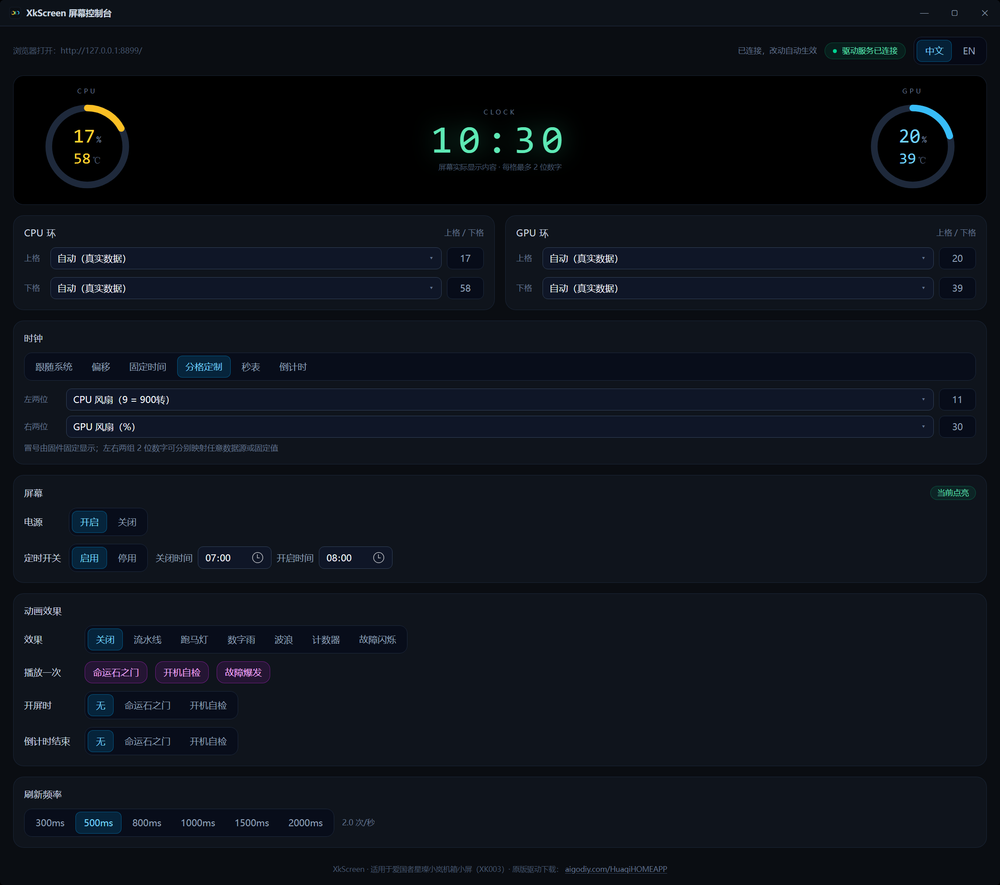

<div align="center">
  
  <h1>XkScreen</h1>
  <p><b>Open-source control suite for the Xingcan / XK003 chassis LCD</b><br/>
  Put <i>any</i> sensor data on the little screen's CPU/GPU rings and clock — with a modern web console.</p>
</div>

<p align="center">
  
  
  
  
  
  
  
</p>

<p align="center"><b>English</b> | <a href="README.zh-CN.md">简体中文</a></p>



## ✨ Features

- **Any data on the rings** — map each of the four numeric slots (CPU ring top/bottom, GPU ring top/bottom) to any of 19 live sources: CPU/GPU load, temperature, clock, power, voltage, fan RPM, RAM usage, network speed, disk activity — or fixed values.
- **Full clock control** — follow system time, offset (fast/slow by N minutes), fixed display, **stopwatch** (MM:SS), **countdown**, or **split mode**: drive the clock's two 2-digit groups independently with any data source or fixed value (`split:cpu_temp,mem_pct` → `44:47`; the colon is firmware-drawn). All with start / pause / resume / reset buttons. Timer frames are aligned to the second boundary so the display ticks crisply.
- **Screen animations** — turn the digits into light: a **pipeline** (numbers flowing across the display), **marquee** (`88` racing through the cells like an RGB chase), **digital rain**, **wave**, **counter** and **glitch** modes, each with its own target (clock / rings / all) and speed. One-shot shows include the **Steins;Gate divergence-meter scramble** (digits flicker, then lock onto the real values one by one), a **boot scan** and a **glitch burst** — and the scramble can fire automatically on screen-on or when a countdown hits 00:00.
- **Screen power & schedule** — turn the display off/on with one click, or set a daily off-window (e.g. dark from 23:30 to 07:00, midnight wrap supported). While off, all frames pause — the panel goes dark and the driver idles — and resuming re-arms the device with a fresh handshake.
- **Live web console** — the driver hosts the UI itself: open `http://127.0.0.1:8899/` in any browser, or use the frameless desktop window (WebView2) with a **tray icon** — hover to see live CPU/GPU/RAM, and the tray menu toggles the screen, opens the web UI, and chooses close-to-tray or exit. Closing to the tray **releases the WebView2 process tree** (≈ 5 MB private / 15 MB total in the tray with a periodic trim, instead of ≈ 490 MB) and reopening rebuilds the UI; a second launch just brings the window back. Chinese / English switchable, changes apply instantly.
- **Lightweight by design** — compiled .NET driver at **~30 MB** resident memory (working set, periodically trimmed) and **≈ 0.05 % CPU idle** (0.9 % of one core; it drives the vendor's sampling itself and skips the multi-tens-of-ms WMI getters it does not need). Console costs nothing when closed; no Electron, no Node.js runtime.
- **Config as code** — one `config.json` plus a local HTTP API (`/status`, `/config`) for scripts and automation.
- **Persistent** — auto-starts at boot (scheduled task, SYSTEM) and keeps the screen alive at your chosen refresh rate (300 ms – 2 s).

## 🔧 How it works

The screen is a USB HID device (`VID_0145 / PID_1001`). Its firmware theme is **fixed**: the layout (two ring gauges + clock), the colors and the `%` / `℃` symbols are drawn by the device and cannot be changed. What *is* programmable — verified exhaustively in the [RE notes](docs/RE-NOTES.md) — is:

1. **the numbers**: each ring area has two 2-digit slots (0-99) that can show any data you feed them;
2. **the clock area**: an MM:SS style display you can drive with real time, offsets, or your own timers.

XkScreen drives the device through the vendor's installed components (see Requirements) and re-implements the frame pipeline with a single-frame-per-cycle design, per-slot data overrides and an adaptive refresh scheduler.

## 📦 Requirements

| | |
|---|---|
| OS | Windows 10 / 11 x64 |
| Vendor software | The original **SystemTemperatureMonitoring** (Xingcan screen utility) must be installed — XkScreen reuses its `XKWLib.dll` / `TempComm.dll` / `HardwareHelp64.dll` / CPUID SDK components for the device chain and hardware telemetry. **These files are not bundled in this repository.** |
| Privileges | Administrator (the CPUID SDK needs driver-level hardware access to read sensors; a non-elevated start has no sensor data and the console shows a warning banner) |
| Build tools | .NET SDK 8+, Node.js 20+ (frontend only) |

Point XkScreen at the installed vendor folder with `--official-dir <path>`, the `XKSCREEN_VENDOR_DIR` environment variable, or a `vendor` folder next to the executable.

## 📥 Install

**A. One-click installer (recommended)** — download `XkScreen-Setup-*.exe` from [Releases](https://github.com/Arimayuki03/xkscreen/releases) and double-click it (administrator rights / one UAC prompt):

- detects the installed original **SystemTemperatureMonitoring** and copies the components it provides (install that first — it is not redistributed here)
- sets the original service `SystemTemperatureMonitoring` to **manual start** (it would otherwise fight XkScreen for the screen) and restores auto-start on uninstall
- installs to `C:\XkScreen` (deliberately a no-space path: this machine's Task Scheduler rejects spaced task targets)
- registers a boot-time task (SYSTEM) plus an hourly **watchdog** (restarts the driver if it ever dies, and proactively every 48 h to sidestep the Task Scheduler's default 72 h execution limit)
- creates Start-menu/desktop shortcuts and offers to launch the console at the end; the uninstaller lives in the Start menu and keeps `%ProgramData%\XkScreen\config.json`

**B. From source** (development / custom builds) — see below.

## 🚀 Quick start (from source)

```powershell
# 1. frontend (Next.js static export)
cd product\frontend
npm install
npm run build

# 2. driver service + console (both non-trivial builds)
cd ..\XkScreen.Service ; dotnet build -c Release
cd ..\XkScreen.Gui     ; dotnet build -c Release

# 3. run the driver (as Administrator) — then open http://127.0.0.1:8899/
product\XkScreen.Service\bin\Release\net48\XkScreen.Service.exe --official-dir "D:\path\to\official"
```

The desktop console (`XkScreen.Gui.exe`) loads the UI from the driver itself and falls back to its embedded copy when the driver is not running.

## ⚙️ Configuration

Everything lives in `C:\ProgramData\XkScreen\config.json` (hot-reloaded; edits apply within ~0.4 s):

```json
{
  "cpu": ["cpu_load", "cpu_temp"],
  "gpu": ["mem_pct", "net_down_x10"],
  "time": "auto",
  "interval_ms": 500,
  "screen": "on",
  "schedule": { "off": "23:30", "on": "07:00" },
  "effect": "off",
  "effect_target": "all",
  "effect_speed_ms": 120,
  "effect_on_screen_on": "none",
  "effect_on_timer_end": "none"
}
```

### Data sources (each slot shows at most 2 digits, 0-99)

| Token | Shows | Scale |
|---|---|---|
| `auto` | vendor's real data for that ring | — |
| `cpu_load` / `cpu_temp` | CPU usage % / package temperature | as-is |
| `cpu_clock` | CPU clock | GHz ×10 (`52` = 5.2 GHz) |
| `cpu_watt` / `cpu_watt10` | CPU package power | W (≤99) / W ÷10 (`15` = 150 W) |
| `cpu_volt` | CPU voltage | V ×10 (`12` = 1.2 V) |
| `gpu_load` / `gpu_temp` / `gpu_clock` | GPU equivalents | clock: GHz ×10 |
| `gpu_fan` | GPU fan load | % 0-99 (NVIDIA NVML; `0` = zero-fan idle, fans physically stopped) |
| `mem_pct` / `mem_used_gb` | RAM usage % / used GB | as-is |
| `net_down` / `net_up` | network download / upload | MB/s |
| `net_down_x10` / `net_up_x10` | same, ×10 resolution | `12` = 1.2 MB/s |
| `fan_rpm` | CPU fan | rpm ÷100 (`9` = 900 rpm) |
| `hdd_load` | disk activity % | as-is |
| a number, e.g. `50` | fixed value | literal |

### Clock modes

| Value | Meaning |
|---|---|
| `auto` | follow system time |
| `+90` / `-30` | fast / slow by N minutes |
| `HH:MM` | freeze at a time (hour may be 0-99) |
| `split:L,R` | map the clock's two 2-digit groups independently: any data-source token or fixed number per side (e.g. `split:cpu_temp,mem_pct` shows `44:47`) |
| `timer` | stopwatch counting up (MM:SS) |
| `timer_from:MM:SS` | stopwatch pre-set to a value |
| `timer_paused:MM:SS` | frozen stopwatch display |
| `timer_down:MM:SS` | countdown, stops at 00:00 |
| `timer_down_paused:MM:SS` | frozen countdown display |

### Animations

The panel can only change digit *values* (colors and brightness are firmware-fixed), so every effect is a scripted value sequence over the six display cells — rings CPU top/bottom, GPU top/bottom, and the clock's two 2-digit groups. Effects run at `effect_speed_ms` (60-1000 ms) and always layer on top of the real data.

| `effect` | Effect |
|---|---|
| `off` | no animation (default) |
| `scroll` | **pipeline** — a conveyor belt: digits slide one position per tick with fresh values streaming in |
| `chase` | **marquee** — an `88` races through the cells like an RGB chase |
| `rain` | **digital rain** — every targeted cell goes random each tick |
| `wave` | a sine wave travels along the cells |
| `counter` | multi-speed counters (clock = 4-digit counter) |
| `glitch` | real data with occasional corruption bursts |

`effect_target`: `clock` | `rings` | `all` (default).

One-shot animations can be played at any time from the console or the API — they layer over the current persistent effect and settle back onto real data:

| `POST /effect` name | Show |
|---|---|
| `steinsgate` | **divergence-meter scramble**: digits flicker randomly, then lock onto the real values one by one (~3 s) |
| `boot` | all-`88` flash, odometer ramp, settle (~1.8 s) |
| `burst` | short heavy glitch (~0.9 s) |
| `stop` | cancel the running one-shot |

Two automatic triggers: `effect_on_screen_on` plays a one-shot when the screen powers on; `effect_on_timer_end` when a countdown reaches `00:00` (both accept `none` | `steinsgate` | `boot`).

### Screen power

| Value | Meaning |
|---|---|
| `"screen": "on"` | display active (default) |
| `"screen": "off"` | pause all frames — the panel goes dark |
| `"schedule": {"off": "HH:MM", "on": "HH:MM"}` | optional daily off-window (wraps midnight automatically). Effective off = manual off **or** inside the window |

## 🌐 Local API

The driver serves both the UI and a small JSON API on loopback only (`127.0.0.1:8899`):

- `GET /` — the web console (also 200 for any asset under `/_next/...`)
- `GET /status` — `{ ok, config, sensors, show, screen, sensors_active }` (`show` = what the clock area currently displays, `screen` = effective power state, `sensors_active` = false when the service runs without sensor access)
- `POST /config` — validated config save (same schema as `config.json`)
- `POST /effect` — play a one-shot animation: `{"name":"steinsgate","target":"all","duration_ms":3200,"speed_ms":90}` (`name` = `steinsgate` | `boot` | `burst` | `stop`)
- `GET /perf` — timing self-check of one sampling pass and of the per-cycle sensor read / frame building

## ⚠️ Known limitations

- **The screen theme is firmware-fixed** — layout, colors, labels and unit symbols cannot be changed (verified; see [RE notes](docs/RE-NOTES.md)).
- **Two digits per slot** — values are clamped to 0-99; use the `÷10` / `×10` variants for large scales.
- **Vendor runtime dependency** — the vendor DLLs are required at runtime and are not redistributed here; install the original software first.
- Personal hobby project: some helper scripts under `.tools/` contain machine-specific absolute paths — adapt them to your environment.

## 🙏 Acknowledgements

Special thanks to the projects and tools that made this work possible:

- **[REA — Reverse Engineering Assistant](https://github.com/morluto/rea)** by [@morluto](https://github.com/morluto) — the reverse-engineering assistant that powered the protocol analysis, disassembly, decompilation and differential experiments behind this project. Its structured, evidence-first tooling shaped how the screen's capabilities were mapped out (see [RE notes](docs/RE-NOTES.md)).
- [ILSpy / ilspycmd](https://github.com/icsharpcode/ILSpy) — .NET decompilation of the vendor libraries (`XKWLib.dll`, `HardwareHelp64.dll`), which revealed the complete data flow.
- [Capstone](https://github.com/capstone-engine/capstone) & [pefile](https://github.com/erocarrera/pefile) — native disassembly and PE inspection of `TempComm.dll`.
- [Frida](https://frida.re/) — runtime hooking that captured the real HID frame protocol (the "gold standard" recordings behind the final frame design).
- [Unicorn Engine](https://www.unicorn-engine.org/) — emulation used to verify the packet builders.
- [USBPcap](https://desowin.org/usbpcap/) & [innoextract](https://constexpr.org/innoextract/) — early capture/extraction attempts that shaped the final methodology.
- [hidapi](https://github.com/libusb/hidapi) — direct HID experiments.
- [Pillow](https://python-pillow.org/) — programmatic generation of the app icon.
- The stacks this product is built on: **.NET Framework**, **WPF**, **Microsoft Edge WebView2** (console), and **Next.js / React / Tailwind CSS** (web UI).
- The original vendor software's components (XKWLib / TempComm / CPUID SDK) — reused at runtime for the device chain and hardware telemetry; they are the interoperability reference this project builds upon.

Developed with the assistance of the **ZCode** coding agent.

## ⚖️ Disclaimer

Unofficial community tool for interoperability and educational purposes. Not affiliated with, endorsed by, or connected to Xingcan or any screen vendor. No vendor binaries are distributed in this repository; all protocol knowledge was obtained by reverse engineering the locally installed software for interoperability. Use at your own risk.

## 📄 License

[MIT](LICENSE)
